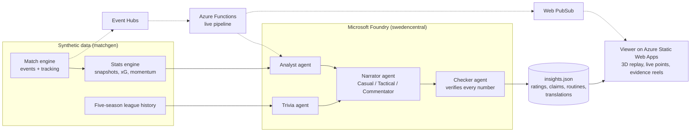

# Sightline

**Explainable match intelligence for the second screen: every insight comes with the numbers behind it and the moments that prove it.**

Demo video: _TBC (link here)_ · Live app: _TBC (Static Web App URL here)_

**The problem.** Football talk runs on vibes. "They've lost the momentum", "he's having a nightmare", "the centre back is carrying them": pundits and fans make claims in real time with no way to check them. The data exists, but it reaches fans as tables they have to decode themselves, and AI summaries make things worse when they invent numbers.

**What Sightline does.** Sightline is a second-screen layer for the Premier League app, built as a feature inside its Match Centre. Pick a lens: **Casual** (plain language), **Tactical** (the numbers and the shape) or **Commentator** (context and trivia a commentator could say on air). As the match plays, live points appear ("Arden's number 5 is holding the back line together"), each with an evidence reel of the exact events for it and against it. Tap a card and the 3D replay jumps to that moment, then returns to the live match. Ratings, a claim checker ("is that true?"), detected set routines and translations sit in their own tabs.

**Why you can trust it.** Code computes every number; the AI agents only phrase. A deterministic stats engine produces the facts, an analyst agent picks what matters, a narrator writes it for each lens, a trivia agent adds sourced history, and a **checker agent verifies every number in the text against the stats** before anything is shown, retrying or dropping the line if it fails. Every insight carries a receipt: model, latency, tokens, which agents ran, and whether the check passed.

## Architecture



Dotted lines are the optional live path. Without it, the same agents run ahead of time over the full match and the viewer replays their output.

## Microsoft technologies

| Technology | Where it is used |
| --- | --- |
| Microsoft Foundry (AI Services account, project, model deployment) | Runs the analyst, trivia, narrator and checker agents (`agents/`) |
| Azure Static Web Apps (Free) | Hosts the viewer (`viewer/`) |
| Azure Storage | Match, history and insights data |
| Managed identity and Entra ID roles | Keyless access from hosted code to Foundry and Storage |
| Application Insights and Log Analytics | Agent latency, token use and pipeline telemetry |
| Azure Event Hubs (optional) | Live match feed from `matchgen stream --sink eventhub` |
| Azure Functions, Flex Consumption, Python (optional) | Live pipeline and the claim check API (`live/`) |
| Bicep | All infrastructure as code (`infra/`) |

## Run it locally

```bash
cd viewer
npm install
npm run dev        # http://localhost:5173, demo match already packed in public/data
```

The viewer works with no cloud at all: it ships precomputed insights in fallback mode. To regenerate data, see `matchgen/README.md` (`python -m matchgen generate --seed 587 --script demo --out out/demo`).

## Deploy to Azure

```bash
az login            # once
./infra/deploy.sh
```

This creates `sightline-rg` in UK South (Foundry in Sweden Central), deploys the Bicep, builds the viewer, uploads it to the Static Web App and prints the URL plus the `export FOUNDRY_ENDPOINT=...` lines that let the agents run live. If the model deployment fails for quota, the script says how to switch models. Details in [`docs/deploy.md`](docs/deploy.md).

## Data

Everything is synthetic and fictional: clubs, players, matches and the five-season history are generated by `matchgen`. No real match data, club names, crests or logos are used. The event format takes its idea from SPADL (the Soccer Player Action Description Language from the KU Leuven sports analytics group): one row per on-ball action with a start and end location, a type and a result, extended here with tracking-based context such as pressure and defenders in the shooting lane.

## Honest status

| Part | Status |
| --- | --- |
| Synthetic match engine, stats engine, league history (`matchgen/`) | Built and tested |
| 3D replay viewer with live points and evidence reels (`viewer/`) | Built |
| Agent layer on Foundry (`agents/`) | Runs live when `FOUNDRY_*` is set; otherwise falls back to templated text and marks `"mode": "fallback"` |
| Ratings, claim checker, routine detection, translations (`agents/extras/`) | Precomputed files ship with the viewer, so they work with no backend |
| Live pipeline (Event Hubs, Functions, Web PubSub) | Optional, behind a deploy flag; the demo replays a precomputed match |
| Azure infrastructure (`infra/`) | Written and reviewed; deployed by the owner from a laptop |

What is live and what is fallback is always visible in the app: every insight's receipt says `live` or `fallback`.

**Roadmap:** real-time agents on every event through the live path; personal follow lists (players, clubs) with push moments; a broadcaster mode that feeds commentators the verified line; on-device translation; evaluation of insight quality against human analysts.

## Repository

```
matchgen/   synthetic match engine, stats engine, league history
viewer/     Vite + TypeScript + Three.js app (Match Centre style)
agents/     Foundry agents: analyst, trivia, narrator, checker
live/       optional live pipeline
infra/      Bicep and deploy.sh
docs/       contract, deploy guide, pitch, video script
```
